## About Me {#about}

I’m Yasmeen, and I like making things. Most evenings you’ll find me in my workshop tinkering away, whether that’s tuning a 3D printer until it runs flawlessly, assembling hardware, fixing broken objects from around the house, or hand-painting a miniature down to the last detail. It’s taught me patience and how the work is as enjoyable as the result.

By day, I’m a Senior Consultant on PwC’s Engineering, Cloud, and Data team. I build machine learning, analytics, and data systems for financial services and government entities, a path that began after my graduation with a B.Sc. in Computer Science from King Saud University.

I’m now applying to pursue a master’s degree to contribute to furthering systems that perceive and interact with the physical world; an area where cameras, sensors, and learning meet.

## Publication {#publication}

  

    <h3>Analyzing Arabic Twitter-Based Patient Experience Sentiments Using Multi-Dialect Arabic Bidirectional Encoder Representations from Transformers</h3>
    
S. AlMuhaideb, <strong>Y. AlNegheimish</strong>, T. AlOmar, R. AlSabti, M. AlKathery, G. AlOlyyan

    
<em>Computers, Materials &amp; Continua</em>, vol. 76, no. 1, 2023

    
Our capstone project where collected and annotated 12,400 Arabic tweets about Saudi healthcare providers (Fleiss' κ = 0.96) and released them as HoPE-SA, the first public Saudi Arabic patient-experience corpus. Our MARBERT model fine-tuned with a BiLSTM layer reached 98.6% macro-F1, outperforming mBERT and SVM baselines.

    

      <a href="https://doi.org/10.32604/cmc.2023.038368" title="Paper" aria-label="Paper"><i class="fas fa-file-pdf"></i></a>
      <a href="https://github.com/HoPESA-KSU/Patient-Experience-SA" title="Dataset" aria-label="Dataset"><i class="fas fa-database"></i></a>
    

  

  

   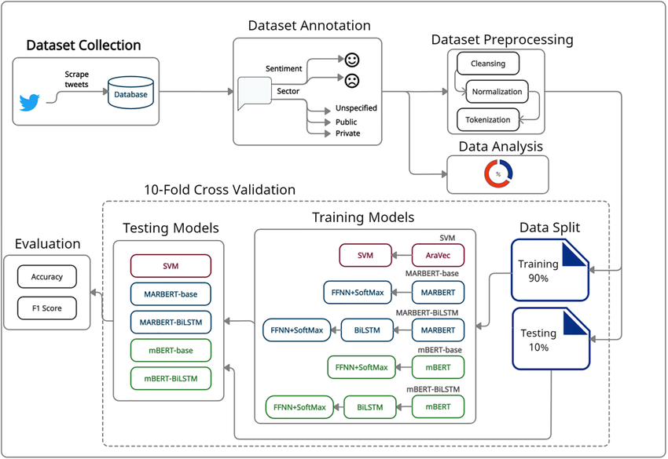
    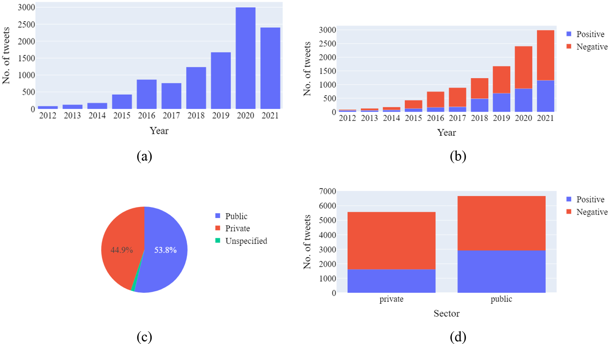
    

## Select Projects {#projects}

  

    <h3>Purrsuit</h3>
    
Personal project (2026)

    
Programmed an Arduino UNO robot car into an autonomous playmate for cats that uses its camera to spot them and lure them into chasing it around the room. Camera frames stream over Wi-Fi to a computer running a YOLO11 model for real-time cat detection, and each detection becomes a motor command to sprint, flee, or tease to keep the game going.

     

  <a href="https://github.com/Yalnegheimish/PurrSuit-Bot" title="Code" aria-label="Code"><i class="fab fa-github"></i></a>

  

  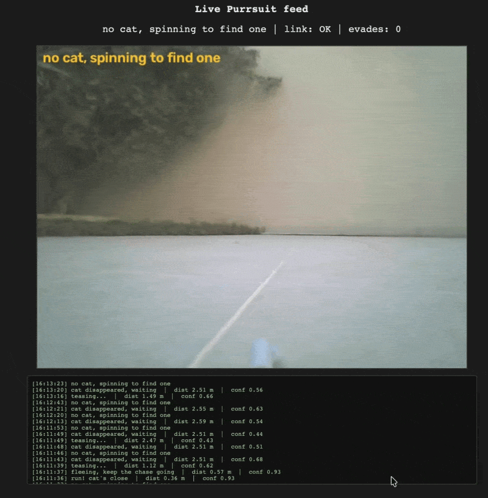

  

    <h3>Bleeding Spot Detection in Wireless Capsule Endoscopy</h3>
    
Computer vision course (2022)

    
Hand-annotated small bleeding spots in 1,275 capsule endoscopy frames, where a swallowed camera films the digestive tract, turning image-level labels into bounding boxes a detector could learn from. Fine-tuned YOLOv5 in PyTorch on this data, reaching a 97.3% F1-score and 95.7% mAP@50. Its accuracy dropped under stricter box-overlap requirements, showing it found lesions reliably but outlined them loosely.

  

  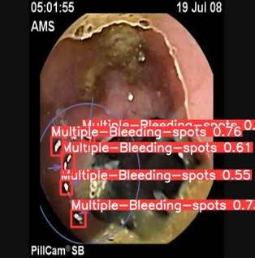

  

    <h3>Solving the Bridge and Torch Puzzle with Search</h3>
    
Artificial Intelligence course (2021)

    
Formulated the classic Bridge and Torch puzzle as a state-space search problem and solved it in Java with Uniform-Cost Search (UCS), Iterative Deepening Search (IDS), and A*, testing on groups of three to eight people. A* and UCS always found the fastest crossing, but UCS’s time and memory grew exponentially with group size. For example, for eight people, A* explored about 180 times fewer nodes (368 vs. 67,247). IDS, on the other hand, used the least memory but never found the fastest crossing.

  

    

   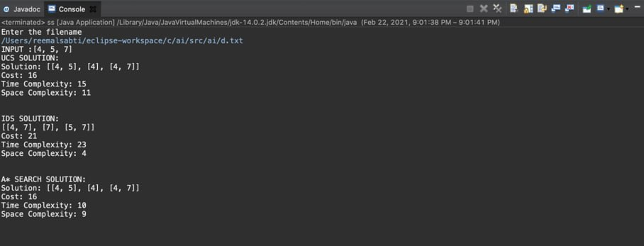
   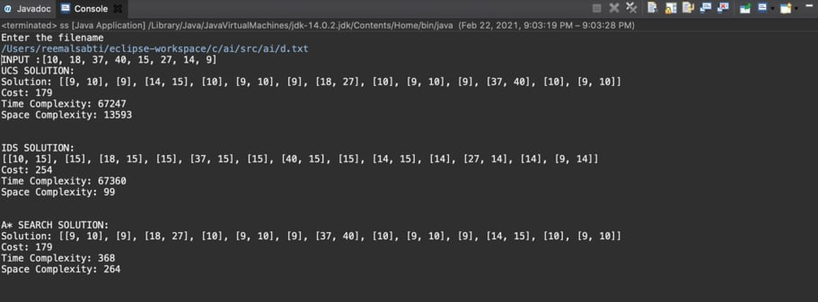
    

## Workbench {#workbench}

Most of my free time is spent in my home workshop, where I 3D print, build, and hand-paint. Below is a selection of my work.

<a href="/images/workbench/workshop.jpg" class="glightbox" data-gallery="workshop">
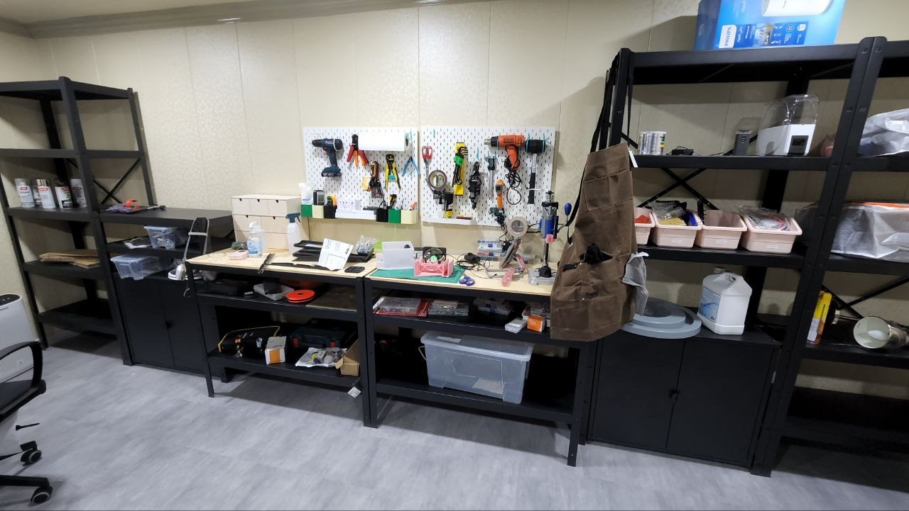 </a>

### Select Builds

  <!--Turntable-->
  <figure>
    <a href="/images/workbench/turntable1.gif" class="glightbox" data-gallery="builds">
      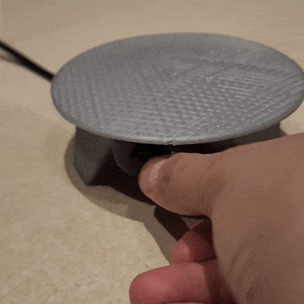
    </a>
    
    <figcaption>Motorized Turntable for Photography</figcaption>
  </figure>
  <!--Fume extractor-->
  <figure>
    <a href="/images/workbench/fume.jpg" class="glightbox" data-gallery="builds">
      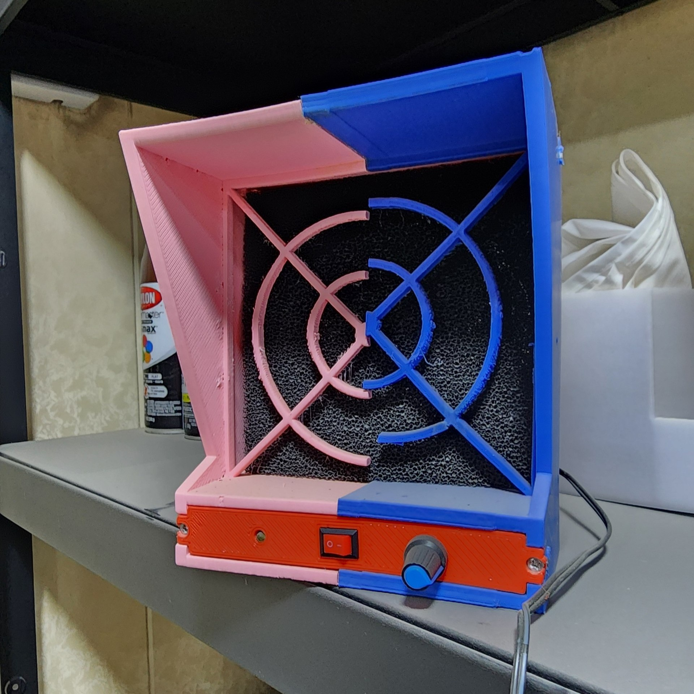
    </a>
    <figcaption>PC Fan Soldering Fume Extractor</figcaption>
  </figure>
  <!--Shoretrooper-->
  <figure>
    <a href="/images/workbench/shoretrooper.jpg" class="glightbox" data-gallery="builds">
      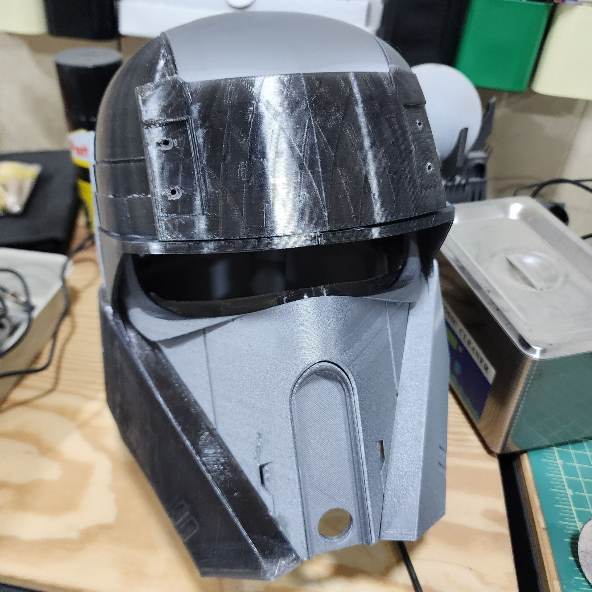
    </a>
    <figcaption>[WIP] Star Wars Shoretrooper Helmet</figcaption>
  </figure>
  

### Select Painted Miniatures

  <!--Alva-->
  <figure>
    <a href="/images/workbench/alva.jpg" class="glightbox" data-gallery="minis">
      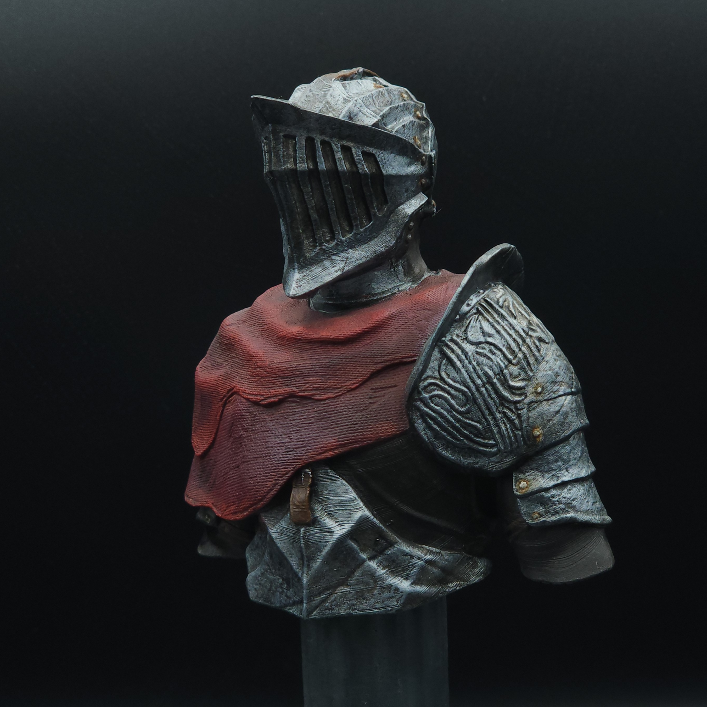
    </a>
    
    <figcaption>Alva, Seeker of the Spurned (Resin 3D Printed) - Model by <a href="https://www.printables.com/model/505406-alva-seeker-of-the-spurned-dark-souls-pre-supporte">Dante Zuck</a></figcaption>
  </figure>
  <!--Mighty Knight-->
  <figure>
    <a href="/images/workbench/mightyknight.jpg" class="glightbox" data-gallery="minis">
      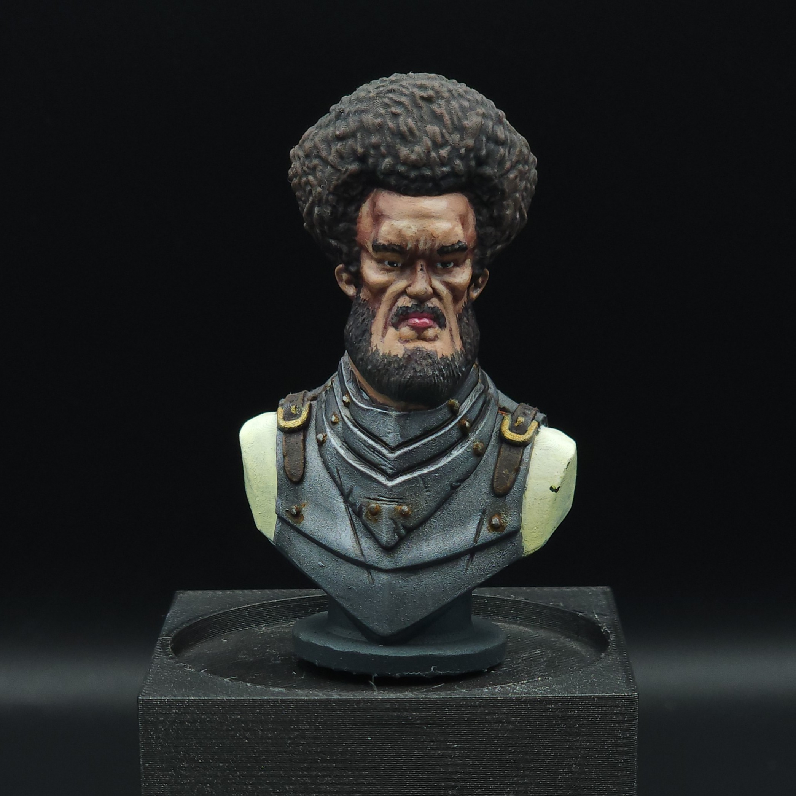
    </a>
    <figcaption>Mighty Knight (Resin 3D Printed) - Model by <a href="https://www.myminifactory.com/object/3d-print-hello-potion-seller-bust-pre-supported-119306">TytanTroll Miniatures</a></figcaption>
  </figure>
  <!--Thorvin-->
  <figure>
    <a href="/images/workbench/dwarf.jpg" class="glightbox" data-gallery="minis">
      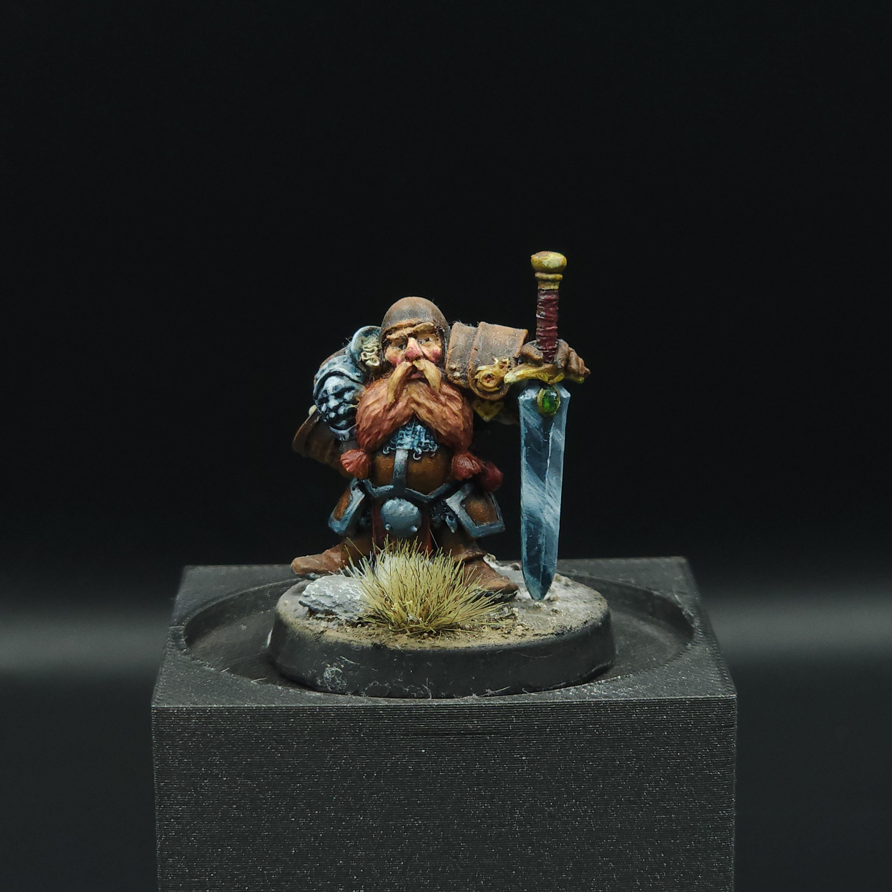
    </a>
    <figcaption>Thorvin, The Great - Model by <a href="https://ak-interactive.com/product/thorvin-the-great-35mm/">Rage Resin Models</a></figcaption>
  </figure>
  <!--Detritus-->
  <figure>
    <a href="/images/workbench/detritus.jpg" class="glightbox" data-gallery="minis">
      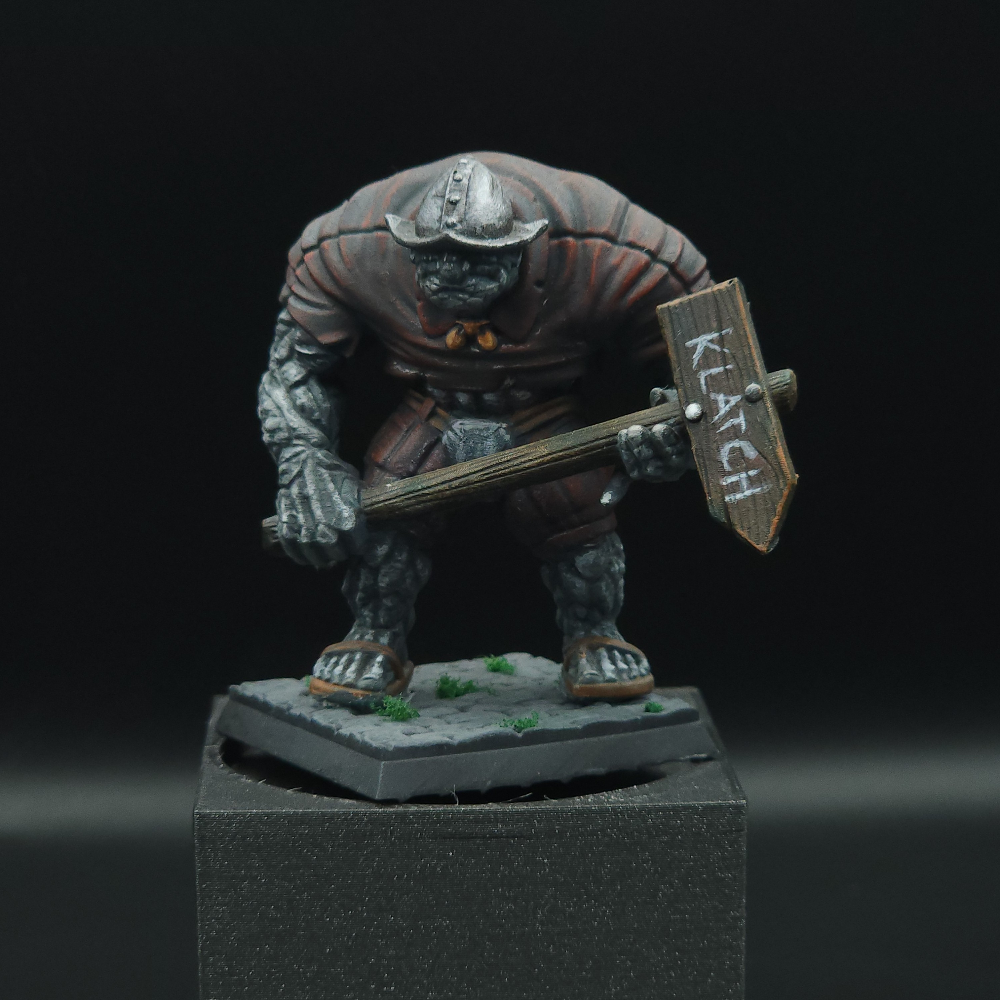
    </a>
    <figcaption>Detritus (Resin 3D Printed) - Model by <a href="https://cults3d.com/en/3d-model/game/discworld-the-watch-pack-pre-supported">TytanTroll Miniatures</a></figcaption>
  </figure>
  <!--Jeff-->
  <figure>
    <a href="/images/workbench/jeff.jpg" class="glightbox" data-gallery="minis">
      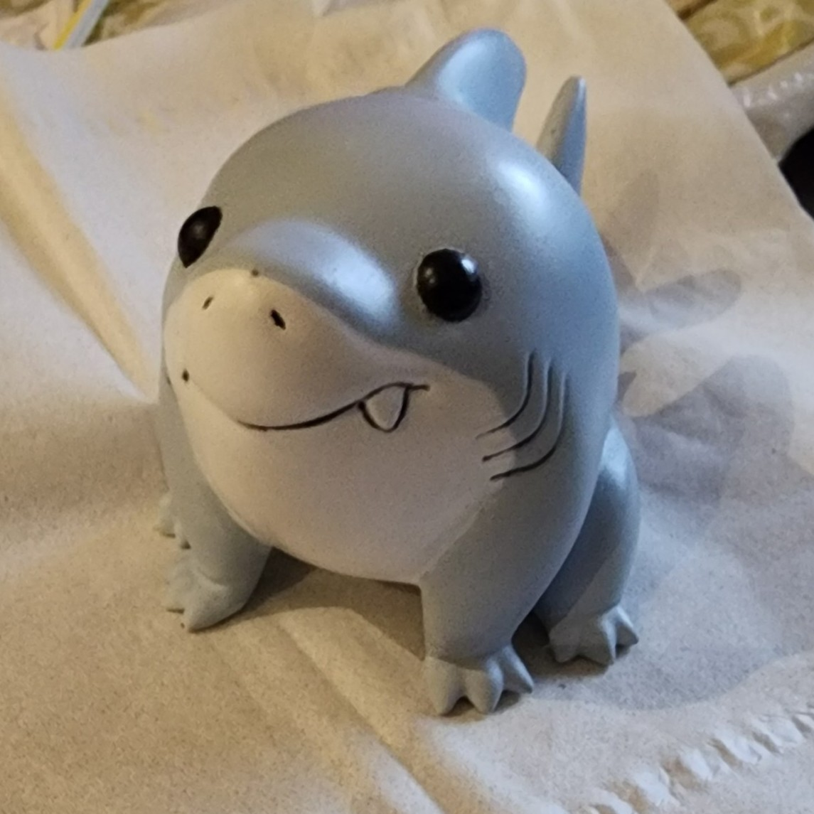
    </a>
    <figcaption>Jeff The Landshark (Resin 3D Printed) - Model by <a href="https://cults3d.com/en/3d-model/art/hq-jeff">EX_DESIGN</a></figcaption>
  </figure>
  <!--Ork-->
  <figure>
    <a href="/images/workbench/orkwarboss.jpg" class="glightbox" data-gallery="minis">
      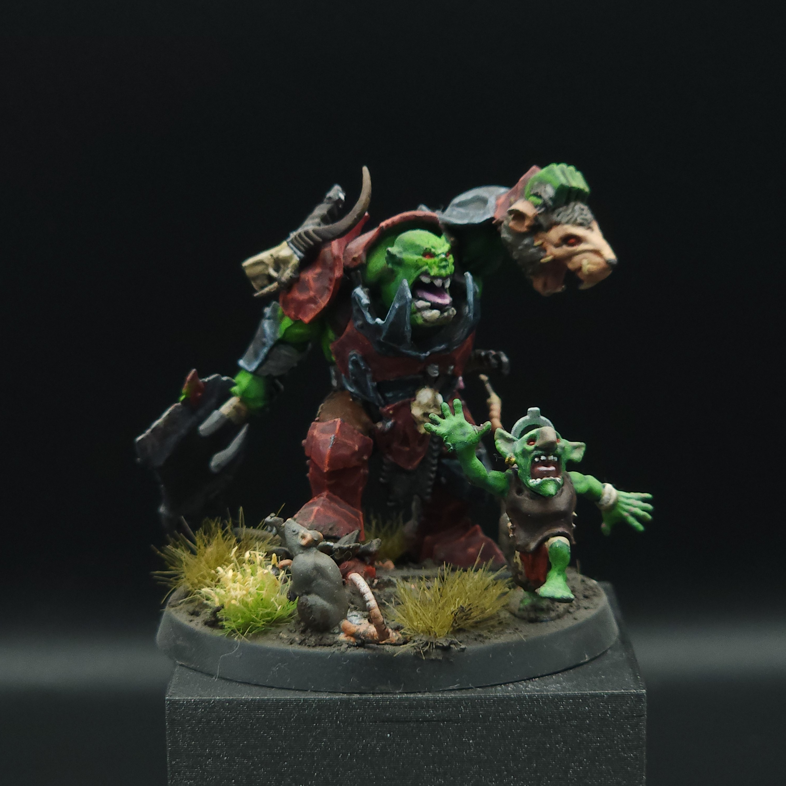
    </a>
    <figcaption>Bawla and Burk - Model by Games Workshop</figcaption>
  </figure>

